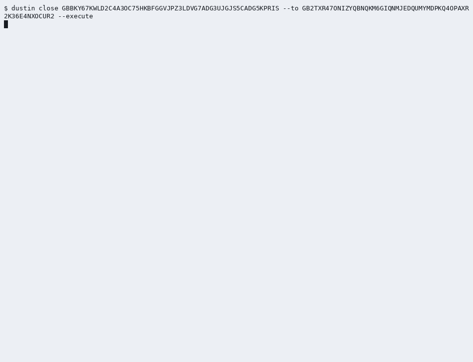

# The 60-second demo

SOW Deliverable 2 and the documentation row of SOW 6.1 ask for a 60-second video that shows the close from the CLI, start to finish (story E4-S6). The hosted video is the take of 2026-10-11, produced from the rehearsal script by `scripts/demo/make-demo.mjs` on a fresh `messy` fixture on the testnet, with its browser shots from StellarExpert's testnet explorer as the storyboard asks (the builder's decision K6 of 2026-09-30), to which the builder added a voice-over on 2026-10-14 ([`docs/demo-voice-over.md`](../../docs/demo-voice-over.md)) and which the builder approved and published on 2026-10-15 as an asset of the `v0.1.0` GitHub release. The takes of 2026-09-29 and 2026-09-30 came before it on the history that was republished on 2026-10-10 (below). This page holds the hosted video's record and its link.

| Field | Value |
|---|---|
| Video link | [dustin-demo-first-sow.mp4](https://github.com/mkaya13/dustin/releases/download/v0.1.0/dustin-demo-first-sow.mp4), an asset of the [`v0.1.0` release](https://github.com/mkaya13/dustin/releases/tag/v0.1.0), published 2026-10-15; also on [YouTube](https://www.youtube.com/watch?v=JoTat4bXGR0), uploaded by the builder on 2026-10-17 ([`docs/runbooks/release.md`](../../docs/runbooks/release.md), step 4) |
| File | `evidence/demo/dustin-demo-first-sow.mp4` on the machine that made it; ignored by git (`.gitignore`), 15,716,048 bytes. The silent cut the take produced, `evidence/demo/dustin-demo-60s.mp4` (SHA-256 `25e5ae082283d19c82c47f7e6e9104e7036298301ca50bb7452d452c69c1c7cd`), is its picture |
| Duration | 0:59.8 (59.80 s) |
| Format | 1920 x 1080, H.264, 30 frames per second, with the builder's voice-over; the captions make it readable with the sound off |
| SHA-256 of the file | `ab704f3d01b99e9f1465716467564da4dfd90f8eb0a908c48c83e1145ece4656` |
| Captions | burned in on a band at the top, and the sidecar [`dustin-demo.srt`](dustin-demo.srt) (the same seven captions as every take) |
| Recorded on (UTC) | 2026-10-11, 15:50:17 onwards (the three terminal recordings; the close in ledgers 5,142,065 to 5,142,067), the pages after it right after; the voice-over added on 2026-10-14 |
| Fixture closed in the video | `messy-20261011T155021Z-0af7a2`, account `GBBKY67KWLD2C4A3OC75HKBFGGVJPZ3LDVG7ADG3UJGJS5CADG5KPRIS` |
| Its three transactions | `3477ef22f63396bbaf4f3f7c6f7ce5a29e7d73a64aeda49d33033655638411f4`, `2b28811cab502756d77863c8bc2298a2c8d642758ec08f978a5d7eb5815325a6`, `e3c6cd1ff35493af3b90bcc1691a14844f587f40da80f8832e1e2cb4d9b59b77` (on the end card) |
| The browser shots | Before the close: the account on StellarExpert, its balances (4 XLM and the four dust balances), its data entry and the sponsored reserve, then its history with the two offers and the data entry being created. After it: the same page loaded again, "Account (deleted)" with the merge first in its history, then Horizon's 404 "Resource Missing" |
| CLI version shown | `dustin` 0.1.0, the build of the commit the take ran on |
| Record of the take | [`take-20261011T155017Z/summary.md`](take-20261011T155017Z/summary.md): the accounts and transactions with their links, Horizon's records, the cut shot by shot, the three terminal recordings and eight key frames |
| A short GIF | [`dustin-demo.gif`](dustin-demo.gif): the close from the confirmation to the receipt, cut from this take |

## The earlier takes

The take of 2026-09-30 ([`take-20260930T170141Z/summary.md`](take-20260930T170141Z/summary.md)) showed the same close on fixture `messy-20260930T170147Z-b5d6bd` with StellarExpert's pages (59.80 s, SHA-256 `6d2fe4c0afc2be94cb2b5cf056fcda4c1bb5a314a34903d87cda13b8538740dc`); its video file is not in the working copy the hosted take was made from. The take of 2026-09-29 ([`take-20260929T184550Z/summary.md`](take-20260929T184550Z/summary.md)) showed the same close on another fresh fixture, with its browser shots from Stellar Explorer (https://testnet.steexp.com) and Horizon, because StellarExpert's testnet explorer had stopped ingesting ledgers that day. Its video is kept, not in git, as `evidence/demo/dustin-demo-60s-take-20260929T184550Z.mp4` on the machine that made it (14,290,298 bytes, 59.80 s, SHA-256 `7de0640d94ccc669efa14fdcc3d46af177874a79eaa76152c2f5ca16cdbc2f1b`); its captions and GIF moved into its take directory on 2026-09-30. It stays usable if the builder prefers it.

## How it was made

The rehearsal script [`docs/demo-video-script.md`](../../docs/demo-video-script.md) is the shot list and the exact commands (the builder decided that the rehearsal lives there, PRD decision D-14; story E4-S6's criterion AC-E4-S6-3 names `evidence/demo/script.md`, and this pointer meets it). Its section "The automated take" says how `scripts/demo/make-demo.mjs` follows it: asciinema recordings of the real commands typed by `scripts/demo/take.exp`, browser pages captured with Playwright, the cut with agg and ffmpeg, every file scanned for secrets and local paths. It also lists the differences from a take by hand; since the second take the browser shots are StellarExpert's, as the storyboard asks, except that its "Active Offers" tab did not render on testnet on 2026-09-30, so the offers are shown by the history of their creation.

To make it again, after a testnet reset or to replace this take: `node scripts/demo/make-demo.mjs --playwright <directory where playwright is installed>` (about six minutes; a new `take-<stamp>/` directory; move the current `dustin-demo-60s.mp4` aside first, since the new take writes over it). A take by hand, following the script, is equally valid.

## Before hosting: what the builder checks

- Watch it once with the sound off: every shot readable at 1080p, the captions in step with the picture.
- Check the frames for anything personal (none is expected: the prompt is `$ `, the pages were captured in a clean headless browser).
- Compare the SHA-256 above with the file being uploaded.

## The reference runs

The CLI metric close recorded on the 0.1.0 code on 2026-09-29 shows the same close from the command line, with `--yes` because a script drove it: [`../runs/20260929T111408Z-e4-cli/transcript.txt`](../runs/20260929T111408Z-e4-cli/transcript.txt) and [`../runs/20260929T111408Z-e4-cli/summary.md`](../runs/20260929T111408Z-e4-cli/summary.md). The first recording, of 2026-09-28, is [`../runs/20260928T112252Z-e3-cli/`](../runs/20260928T112252Z-e3-cli/summary.md).
